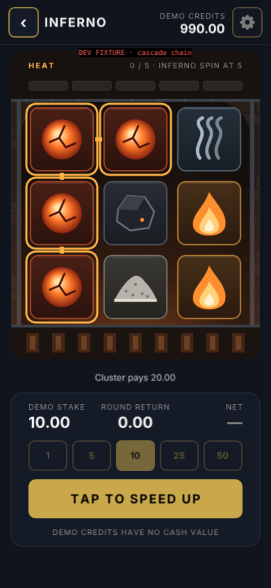

# Inferno polish 001 — Art, audio and timing

## Forge treatment: "Refined 2D Ember Workshop"

The shell follows `docs/polish-003/VISUAL_REVISION_004.md`. It uses the same charcoal/slate panels, a muted champagne accent (`COLOR_GOLD` from `UITheme`, never hard-coded) and the header/stake/return/CTA hierarchy of the approved Jett, Flap and Shatter targets. Inside the board window there is a restrained warm-charcoal forge:

- two-tone sparse brick courses and a dark furnace-arch silhouette behind the board
- two straight iron ribs at the sides
- an iron "hood" band that carries the heat meter (refills drop from behind it)
- a grate under the board with a small warm glow between the bars
- one soft radial glow rising from below

There is no lava cave, photoreal flame, neon or ornate gold frame. Heat and fire colours are semantic: orange segments, ember outlines and sparks. The casino accent is used only for the CTA, stake chips, WILD and positive net.

Everything is code-drawn once:
- **Background:** `drawForgeBackground` → one 358×444 canvas texture.
- **Symbols:** `drawSymbolTile` → one 1568×192 atlas at 2× texture density.
- **Static HUD faces:** baked with `generateTexture`.

Review copies: `review-artifacts/symbol-atlas.png`, `review-artifacts/forge-background-texture.png`.

### Symbol sheet

| Symbol | Pays (×stake, 3-cluster) | Silhouette (not just colour) | Tile tint |
|---|---|---|---|
| EMBER | 0.80 | **Round** glowing orb with dark cracks | Deep red-brown |
| FLAME | 0.50 | **Tall pointed** three-layer teardrop | Amber-brown |
| COAL | 0.35 | **Angular** faceted polygon with one ember speck | Slate |
| ASH | 0.25 | **Low, wide, filled** heap with flecks | Warm grey |
| SMOKE | 0.15 | **Open stroked** rising curls (no fill) | Blue-grey |
| WILD | substitutes | Dark **anvil** on champagne plus the text label "WILD" | Champagne |
| SCATTER | free spins | **Four-point spark in a ring** plus the text label "SCATTER" | Teal |

The two pairs most at risk of confusion are told apart by shape: EMBER (circle) vs FLAME (pointed), and ASH (filled heap) vs SMOKE (open strokes). WILD and SCATTER carry text labels, so they read without relying on colour. Winning clusters use an **outline plus connector bars** (a shape cue) in addition to colour.

### One keyframe board

The image above is the developer fixture "cascade chain": a 4-EMBER L-cluster outlined on **pre-removal** coordinates. The full sequence is in `review-artifacts/keyframes/kf-00…25.png`, with `timeline.json` giving ms since press and the UI phase. The remaining states are in `review-artifacts/screens/` (manifest: `screens/manifest.json`; every fixture state shows a red "DEV FIXTURE" tag).

## Timing (named constants in `INFERNO_TIMING`, `src/games/InfernoUI.ts`)

| Phase | Brief target | Implemented | Behaviour |
|---|---:|---:|---|
| Press feedback | 0–80 ms | 70 ms text squash (35 ms in, 35 ms out) on `pointerdown`; click cue | Spin accepted once. Debit and stake lock happen in the ledger before animation starts |
| Reel entry / stop | 650–900 ms | exit 110 + drop 360 + settle 80, stagger 75 ms → **≈ 700 ms** to the last column landing | Each column drops as a unit. Tap cue on each column's landing |
| Identify cluster | 120–180 ms | **150 ms** outline fade plus 1.06 pulse, then a **160 ms readability hold** | Only actual winning cells (script data) |
| Remove | 100–160 ms | **130 ms** shrink to 0.6 and fade, ≤3 sparks per cell, ≤24 alive board-wide | Ember pop cue. No white flash |
| Survivors fall / refill | 180–260 ms | **220 ms** Quad.easeIn | Real old→new row mapping from `step.moves` / `step.refills`. Refills start above the hood |
| Settle | 60–100 ms | **80 ms** squash-recover (Back.easeOut), then 80 ms before the next evaluation | Land cue |
| Final return | 250–450 ms | **350 ms** count-up | Instant when skipping or with reduced motion. The amount comes from the ledger |
| Heat increment | 150–220 ms | **180 ms** alpha on changed segments only | One finite tween per changed segment |
| Free-spin gap | — | 900 ms (cancellable; the player can tap sooner) | Guarded by round ID |
| Crown flip | — | 460 ms coin turn, then the result held for 460 ms | Both buttons locked throughout |

**Speed controls** are presentation only, via Phaser `tweens.timeScale` and `time.timeScale`:
- Quick spin ×1.8.
- Tapping the board or SPIN during a round ×6 for the rest of that round.

A browser probe confirms identical outcomes across 30/60/120/144 Hz, reduced motion, quick spin, skip and muted audio (`evidence/run/08-determinism-probe.json`).

## Audio

**Status: rendered but not auditioned.** No one listened during this run. Loudness and seam figures are measured. Whether the sound is pleasant is unverified.

- **Generator:** `research/inferno/audio/render-audio.cjs`. Original procedural DSP: sines, light FM, Karplus–Strong plucks, seeded noise and one-pole filters.
- **Encode:** `encode-audio.sh` (ffmpeg).
- **Playback:** Phaser's single `WebAudioSoundManager`. No extra AudioContext, a cap of 6 SFX voices, the profit motif ducks music to 35% for 0.9 s, and music starts only after the first gesture.
- **Settings:** independent levels Off/Low/Medium/High for music and SFX, saved in `localStorage` under `jett.inferno.settings.v1`.

**Music loop:** 16.0 s (6 bars at 90 BPM, A minor).
- Breathing A1/E2 drone, low-passed.
- Soft "furnace pulse" kick on beats 1 and 3, very quiet off-beat brushes.
- A sparse pentatonic pluck phrase (one note per two beats), and a quiet FM "anvil" ping every two bars.
- The tail is wrapped circularly. Seam step |first − last| = 0.0046, against a maximum in-loop step of 0.018, so no click.

| Event | Cue file | Policy (enforced in code) |
|---|---|---|
| Button / start | `click` | Quiet and dry; no profit meaning |
| Reel stop | `reel-stop-1/2/3` (E3/G3/A3 muted taps) | One per column; no bell |
| Cluster removal | `cluster-pop` | Neutral crackle plus a low thump. No fanfare, even when the provisional total exceeds the stake |
| Cascade landing | `cascade-land` (D4→B3 taps) | Short; capped voices prevent build-up |
| Heat tick | `heat-tick` | Only when heat actually rose |
| Feature granted | `feature-granted` | Only on an authoritative free-spin award or a heat-full Inferno Spin |
| Crown flip / win / loss | `crown-flip`, `crown-win`, `crown-loss` (subdued, falling) | Loss stays quiet |
| Final net profit | `result-profit` (A–C♯–E pluck) | **Only** when `selectInfernoOutcomeCue()` returns `profit`: the paid cycle is closed and gross return > paid stake |
| Partial / break-even | `result-neutral` | Neutral; never called a win |
| Zero return | none | Silence |

### Measured loudness (ffmpeg ebur128, `evidence/audio-loudness.csv`)

| File | Integrated LUFS | True peak |
|---|---:|---:|
| Music loop (.ogg) | −30.6 | −11.9 dBTP |
| `result-profit` (.ogg) | −27.5 | −13.0 dBTP |
| `feature-granted` (.ogg) | −22.7 | −12.6 dBTP |
| Other cues (shorter than the 400 ms gating block) | not measurable (−70 reported) | −13.3 … −22.3 dBTP |

Every file is at or below −11.9 dBTP, which meets the proposed ≤ −1 dBTP ceiling with a wide margin. In-game levels then scale further: music 0.18/0.32/0.5 and SFX 0.3/0.55/0.85.

**Audition files:**
- `review-artifacts/audio/inferno-audition-reel.mp3`: 8 s of the loop, then every cue in table order.
- `review-artifacts/audio/inferno-forge-loop-preview.mp3`: the full loop.

Browser evidence (headless Chromium, `evidence/run/06-new-browser-lifecycle-ledger.json → audio`): locked/suspended before the gesture, running with music playing after it, mute and unmute working, the context suspended on blur and resumed on focus, settings persisted across reload. This proves state transitions only, **not audible output**.

## Accessibility alternatives

- **Reduced motion:** a setting that defaults from `prefers-reduced-motion`. No travel, pulse, squash or particles. Cells crossfade in place in 110 ms. Same callbacks, same outcomes.
- **Non-colour cues:** silhouettes, WILD/SCATTER text labels, cluster connector bars, "n / 5" heat text plus the "FULL · NEXT SPIN IS ALL WILD" label, and net shown with an explicit sign (+ / −).
- **Text:** smallest text is 11 px (`FONT_SIZE_XS`); main values are 22 px bold.
- **Touch targets:** every control is at least 44 px tall (chips 56×44, SPIN 308×56, header icons 44×44, Crown buttons 52/44, settings rows 44).
- **Audio:** fully optional, with independent music and SFX controls; nothing plays before a gesture.
- **Pace control:** tap to speed up, plus quick spin.
- **Known gaps:**
  - The canvas is 390×844 CSS-scaled (Phaser FIT, set globally in `main.ts`), so text is soft on high-DPR screens.
  - There is no screen-reader output from the canvas.
  - Landscape letterboxes rather than re-laying out.
  - Text contrast was chosen by eye, not measured with a contrast tool.
