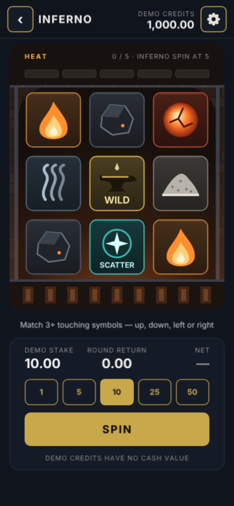
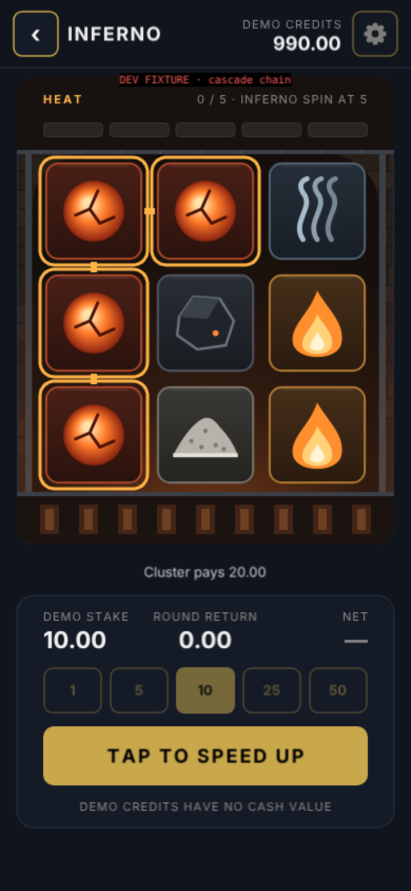
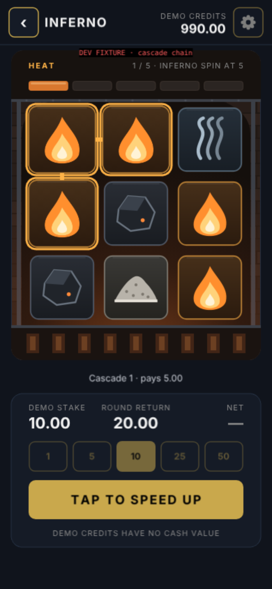
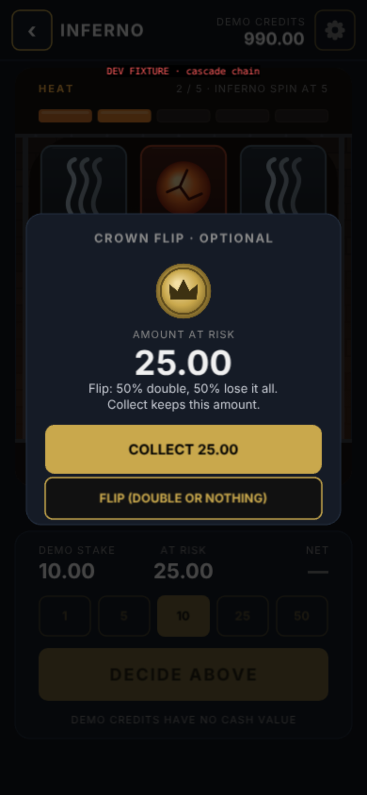
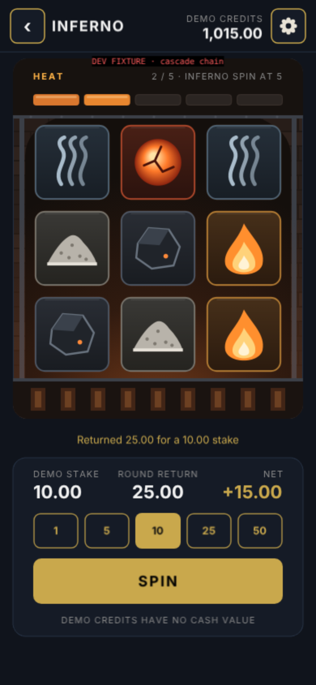
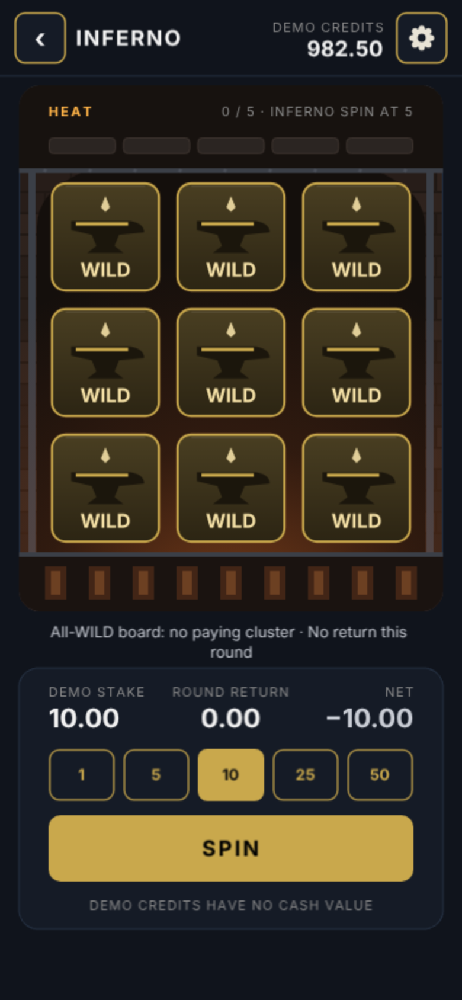

# Inferno polish 001 — Implementation report

**Branch:** `fix/inferno-polish-001`, based on `research/inferno-polish-001@2977ad6` and pushed to GitHub. The commit list is at the end. There is no merge, deploy or `main` change. `deploy.yml` was not triggered, Kuro Director was not touched, and the other games were not modified.

## What changed (files)

| File | Change |
|---|---|
| `src/games/InfernoLogic.ts` | **Logic fix:** survivor order (gravity). Idempotent `evaluateClusters(state, config?)`. Disputed rules are now selectable through `InfernoConfig.rules` (legacy defaults). **New pure APIs:** `resolveInfernoSpin`/`resolveInfernoCascades` (authoritative script with before/after snapshots and old→new moves), the session ledger (`createInfernoSession`, `beginInfernoSpin`, `finishInfernoPresentation`, `crownFlipAction`, `crownCollectAction`, `setInfernoStake`), `isCrownEligible`/`enterCrownFlip`, `selectInfernoOutcomeCue`, milli-credit helpers, `simulateInfernoCycles`, the corrected `simulateInfernoRTP`, `getInfernoMathFingerprint`, `deriveInfernoSeed`/`createInfernoRoundRng`. **All original exports and signatures are kept** (the new optional parameter is backward compatible). No Phaser import. |
| `src/games/InfernoUI.ts` | Rewritten renderer: code-drawn atlas and forge, timed phases, guarded playback tokens, Crown decision with COLLECT as default, settings panel, reduced motion, quick spin, tap to speed up, baked HUD faces, particles capped at 24. Input stays on the `drawButton()` `bg`. |
| `src/scenes/InfernoScene.ts` | Wires ledger, UI and soundboard. One RNG per round. Space key ignores auto-repeat. Settings persisted with try/catch. Full shutdown cleanup. Uses Phaser's sound manager only. |
| `src/shared/assetConfig.ts` | **Additive only:** a new `INFERNO_ASSETS` export (audio paths). Existing exports are unchanged. |
| `public/assets/inferno/` | 13 cues (.ogg/.mp3), the loop (.ogg/.wav), `ASSET_SOURCES.md`. 1.1 MB in total, mostly the 768 KB WAV loop fallback. |
| `src/tests/InfernoPolish.test.ts` | 37 new tests. |
| `research/inferno/**` | Harness (dev only, never imported by `src`), probes, simulators, audio generator, capture scripts. |
| `docs/inferno-polish-001/**` | The five reports, evidence JSON/CSV and review artifacts. |

**Not changed:** `SlotAnimator`, `CasinoAudioManager`, `ProvablyFairRNG`, `UITheme`, `main.ts`, `HomeScene`, and every other game. `src/games/InfernoUI.ts.bak` (a pre-existing file) was left as it was.

**Deviation from the 3-file rule:** none in `src` (Logic, UI, Scene). Offline tools live in `research/`.

## Before / after captures

**Before** (baseline 2977ad6, from the original code): emoji symbols on saturated tiles, a gold frame, separate bet text buttons, and a win badge flash. See the brief's evidence plus `evidence/run/05-baseline-browser-probe.json` for the behaviour defects.

**After:** `review-artifacts/screens/` (23 PNGs at DPR 2; `manifest.json` labels each one as natural or fixture). Selected:

| | |
|---|---|
|  |  |
| Ready (natural) | Cluster identified (fixture) |
|  |  |
| Survivors falling (fixture) | Crown decision, COLLECT primary (fixture) |
|  |  |
| Settled with a positive net (fixture) | Natural all-WILD Inferno Spin: honest zero result |

Other artifacts:
- **Keyframes:** `review-artifacts/keyframes/kf-00…25.png` with `timeline.json`.
- **Symbol atlas:** `review-artifacts/symbol-atlas.png`.
- **Widths:** `21-width-320`, `22-width-430`, `23-landscape-844x390` (letterboxed by FIT).

## Gameplay recording

`review-artifacts/video/inferno-gameplay.mp4` (H.264, ~19 s, **silent**; headless capture cannot record audio). It shows:
1. the dev fixture "cascade chain" with a Crown collect
2. three natural seeded spins

Contact sheet at 2 fps: `review-artifacts/video-contact-sheet.png`. Event timeline: the probe drives press → `presenting` → `decision`/`ready`, and the per-frame phase timeline for the cascade fixture is in `keyframes/timeline.json`.

## Audio preview / status

`review-artifacts/audio/inferno-audition-reel.mp3` and `inferno-forge-loop-preview.mp3`. **Rendered but not auditioned.** Loudness and true peak are measured (`evidence/audio-loudness.csv`). Unlock, mute, blur and persistence state transitions are verified in headless Chromium. Audible output, mix quality and device behaviour are **not** verified.

## Verification evidence

| Check | Result | File |
|---|---|---|
| Baseline reproduction | 7 Logic and 5 browser defects reproduced on the original code | `evidence/run/01-*.json`, `05-*.json` |
| Fixed Logic characterization | Survivor order correct, repeated evaluation credits once, simulator carries heat | `evidence/run/02-*.json` |
| Input races | Triple tap → 1 round, 1 debit. Held Space → 1 round. Stake tap mid-round rejected. Crown COLLECT double tap → 1 credit. | `06-new-browser-lifecycle-ledger.json` |
| Free spins | 1 debit for 6 spins (5 free). Cycle continued after the balance was forced to 0. Stake fixed at 10. | same |
| Crown | Repeated direct `handleFlip`/`handleCollect` calls → exactly 1 credit (the busy guard plus Logic phase guards) | same |
| Exit mid-phase | Restart during spinning / removing-falling / Crown / free-spin cycle / result → 0 tweens, 0 timers and 0 time events left after 1.5 s | same |
| 50 restarts | Display list (90), textures (59), sounds and keyboard listeners (1) stay constant, and the JS heap stays flat at 82 MB from restart 10 to 50. **AudioContexts created: 1.** No page errors. | same |
| Determinism | Identical grids, ledger and balance for rAF, 30/60/120/144 Hz (setTimeout loop), reduced motion, quick spin, skip and muted audio | `08-determinism-probe.json` |
| Phaser APIs | See `REFERENCE_AND_API_RESEARCH.md` | `07-phaser-api-probe.json` |
| Tests / build | **277/277 tests in 16 suites** (baseline 240 + 37 new; 514 s); `npm run build` exit 0 (only Vite's existing chunk-size warning) | `11-final-full-suite.txt`, `12-final-build.txt` |

## Performance (headless Chromium 153, ANGLE/SwiftShader software WebGL, DPR 1, 390×844 canvas; `evidence/run/09-performance.json`, measured at the UI of commit 77ec251; later commits changed only seeding)

| Build | CPU | Idle p50 / p95 (ms) | Spin p50 / p95 (ms) | Spin frames > 50 ms | Peak tweens | Peak display list | Peak particles | Texture estimate | AudioContexts |
|---|---|---|---|---|---|---|---|---|---|
| Baseline | 1× | 16.7 / 16.7 | 16.7 / 16.7 | 1 | 23 | 59 | 0 | 0.23 MB | 2 created, 0 closed |
| New | 1× | 16.7 / 16.8 | 16.7 / **33.3** | 3 | 5 | 90 | 12 | 2.41 MB | 1 |
| Baseline | 4× throttle | 33.2 / 33.4 | 33.3 / 33.4 | 3 | 23 | 59 | 0 | 0.23 MB | 2 |
| New | 4× throttle | 33.3 / 33.4 | 33.3 / **50.0** | 8 | 5 | 90 | 12 | 2.41 MB | 1 |

**Honest reading.** On software WebGL the new presentation costs more per frame during spins: about 42 of 411 spin frames are above 20 ms at 1× CPU.

- **What was measured:** hiding all Graphics brought p95 back to 16.8 ms. Per-frame tessellation of rounded-rect HUD Graphics was the largest cost, so those faces were baked into textures. A baked *full-screen* shell then cost more (software fill rate) and was reverted to live Graphics.
- **What remains:** the forge texture, the 2× symbol atlas and text updates.
- **What the "spin" row covers:** the baseline's spin row has far more frames (simple flashes and longer holds); the new row is a two-cascade fixture.
- **What this is not:** a device benchmark. The 60 fps goal is a target; this is **not a result**. Real Android/iOS measurement is still required.
- **Memory:** the texture estimate counts the atlas (1568×192), the forge background, the baked faces and per-Text canvases.

## Remaining decisions (owner)

The full list is in `BASELINE_AND_DECISIONS.md`. In short:

- **A.** All-WILD Inferno Spin value (current 0; the naive fix gives ≈598%).
- **B.** Scatter without a cluster (an option gives +4.4 pp).
- **C.** The RTP target vs the measured 90.8%.
- **D.** Crown chain cap.
- **E.** A global RNG fix (mask, seed mixing, warm-up) as its own PR.

## Remaining risks

- Audio is unauditioned, and there is no real-device performance or Safari/Android test.
- Canvas text is soft on high-DPR screens (global FIT setup).
- WILD/SCATTER labels use a system font inside the atlas, so glyphs vary by platform.
- Landscape is letterboxed.
- Contrast was not measured with a tool.
- The UI public API changed: `InfernoUI` is consumed only by `InfernoScene`, but external code calling the old `InfernoUI` methods would break. The Logic exports are preserved.
- Inferno uses **local** workarounds (derived seed plus warm-up) for shared RNG defects, and other games still use the shared generator directly.

## Next bounded milestone (proposal)

Owner decisions A–C, then a versioned `inferno-math-3` with a designed Inferno Spin value and/or heat pacing, re-simulated to a chosen target with the same runners. Then real-device performance and audio audition on one Android and one iPhone. The global RNG PR (decision E) stays a separate, reviewable change with every game's tests.

## Plain-text summary for a later graph import

Inferno polish 001: rules and ledger bugs fixed (survivor order, Crown triple credit, free-spin debit, heat tween leak, AudioContext leak). Measured RTP 90.8% (2M cycles), not 96%. All-WILD Inferno Spin pays 0 (open decision). Shared RNG defects: suffix-seed collisions, biased first output, unbounded state. New Refined 2D forge presentation and original procedural audio (unauditioned). Branch fix/inferno-polish-001, not merged.

## Commits
