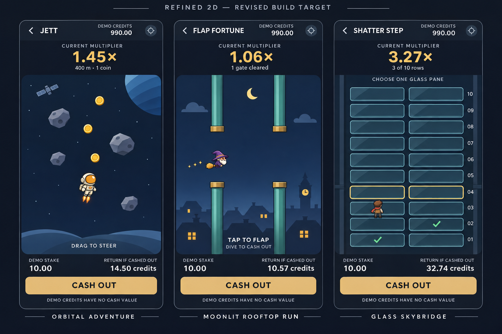
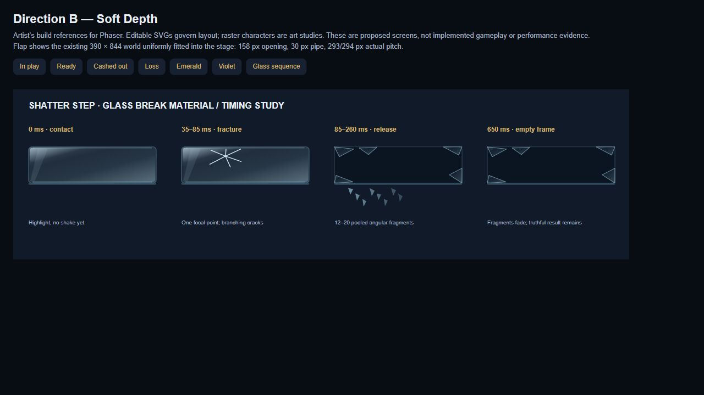

# JETT-POLISH-003 — Opus cloud build handoff

**Status: artist-approved direction, proposed implementation; no production code changed.** Scope: Jett, Flap Fortune and Shatter Step. Engine: existing Phaser 4 + TypeScript. All balances and stakes are non-redeemable demo credits.

The owner selected **Direction B — Soft Depth**, then approved the **Refined 2D revision** below: a happy medium between the original sparse scenes and a later overly detailed painted concept. Read [VISUAL_REVISION_004.md](VISUAL_REVISION_004.md) first for the current art target. Keep the existing character assets; enrich and simplify the environments as specified. This supersedes older background/art recommendations, including polish-002's Direction A proposal. Keep the mechanics while fixing the documented correctness defects.

## Start here

1. Read [the verified Opus audit](../polish-002/EXECUTIVE_REVIEW.md) and [integration handoff](../polish-002/INTEGRATION_HANDOFF.md).
2. Read [the approved visual revision](VISUAL_REVISION_004.md), then [the artist specification](ART_AND_LAYOUT.md). The older [contact sheet](index.html) and committed [Jett](renders/jett-playing-gold.svg), [Flap](renders/flap-playing-gold.svg), [Shatter](renders/shatter-playing-gold.svg) SVGs remain layout/state references only; their sparse backgrounds are superseded. Keep the [glass storyboard](renders/shatter-glass-storyboard.svg) timing requirements.
3. Read [the engineering build contract](BUILD_CONTRACT.md), including pending economics decisions, replay requirements and PR boundaries.
4. Use [the copyable cloud prompt](OPUS_PROMPT.md), [validation report](VALIDATION.md) and [research/provenance](RESEARCH_AND_ASSETS.md).

## Visual package

- `renders/approved-refined-2d-target-v2.png`: latest owner-approved environment/style reference, committed for headless Claude access. It is a concept, not implemented gameplay or a source of exact geometry.
- `renders/`: 36 earlier editable, standalone SVG screens: three games × ready/playing/cashed-out/loss × gold/emerald/violet. Retain their layout/state examples, not the superseded background treatment. One four-panel glass sequence.
- `assets/`: existing transparent pilot and wizard studies remain unchanged. Do not replace them with characters cropped/generated from the new concept. The earlier A/B/C comparison is historical direction context. These PNGs are art inputs, not production-ready animation atlases.
- `design-tokens.json`: semantic palette, exact reference viewport, shell regions and geometry. Keep casino branding behind these tokens; never modify game math for a colour variant.
- `render-mockups.cjs`: regenerates the SVGs, tokens and local preview. It is design tooling only. Run `node docs/polish-003/render-mockups.cjs`, then `npm run dev` and open `/jett-game/docs/polish-003/index.html`.
- `evidence/`: tests and build rerun locally for this handoff. Baseline gameplay captures and performance probes remain under `docs/polish-002/evidence/`.

See also the [baseline-versus-proposal sheet](renders/before-after.jpg), [cash-out results](renders/cashed-out-board.jpg), [loss states](renders/loss-board.jpg), [emerald](renders/emerald-board.jpg) and [violet](renders/violet-board.jpg) skins. These are proposed screens, not implemented after-captures.

**Reference precedence:** verified production logic and explicit bug-fix decisions → exact geometry/layout notes and accessibility requirements → VISUAL_REVISION_004.md plus the latest approved PNG for environment/style → older SVG state/layout examples. Existing character sources remain authoritative for asset identity. A screenshot must never become a source of collision boxes, random outcomes or payout values. The design generator still regenerates the older geometry studies; it does not generate the new background target.

The original research commit `151a5005753d9be45deb82b2ec7b96031ef88549` was fetched from `origin/research/jett-polish-002` and cherry-picked as `b1c7482` onto this handoff branch. Its parent was `616fd82`; the research itself touches no production files. Do not apply an additional patch copy over this commit.

## Next milestone

Deliver correctness fixes and **one polished, tested segment per game**: Jett coin pickup → cash-out; Flap two correctly spaced pipe pairs → cash-out; Shatter three safe choices → either cash-out or one visibly shattered wrong choice. Show actual Phaser screenshots beside these references before expanding the art across all content. Keep shared-system fixes and each game's implementation reviewable separately. No merge, deployment or production change is authorized by this handoff.
