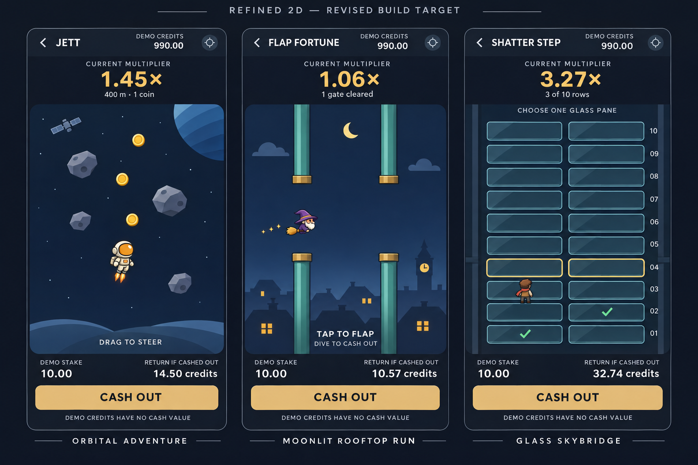

# Approved visual revision 004 — Refined 2D

**Owner instruction:** “That is much better. Now update the build report for Claude. You can keep the assets the same. But this background etc is better.” Approved reference: `renders/approved-refined-2d-target-v2.png`.

This is the current build target for **Jett, Flap Fortune and Shatter Step**. It supersedes the sparse environments in the original polish-003 SVGs and the later detailed, cinematic/painted concept. It does not replace the engineering contract, payout rules, controls, collision dimensions, replay requirements or existing asset identities.

## What changes and what stays

- Keep the existing pilot, wizard and other usable gameplay assets. `assets/jett-pilot-study.png` and `assets/flap-wizard-study.png` are unchanged. Reuse an existing runner if available; no new character redesign is requested. Characters drawn in the reference communicate scale/mood, not mandatory replacements.
- Add the approved environment treatment: simple deliberate shapes, two or three shading tones, muted navy/slate/teal layers, warm highlights and enough detail to give each game a distinct world.
- Keep the modern shared HUD, anchored cash-out footer, muted champagne accent, clear hierarchy and casino colour tokens. Use a flat CTA in implementation; do not reproduce incidental generated gradients, typography distortions or placeholder icons.
- No painted panorama, dramatic fog, heavy bloom, chrome, ornamental casino frames, dense particles or architectural microdetail. Do not return to an almost empty navy stage either.
- The PNG is an artistic concept. Implement the world from reusable layers and sprites, not a single baked screenshot with UI, hazards and characters inside it.

## Jett — restrained orbital adventure

Give the existing pilot a clear orbital setting while keeping hazards easy to read.

| Layer | Build target |
|---|---|
| Far background | Muted navy gradient, sparse fixed star field, one small cropped blue planet with two or three broad bands. Planet is visually subdued and non-colliding. |
| Ambient detail | One small satellite silhouette/sprite, slow or static; cosmetic only. No new collectable or obstacle implied. |
| Depth | Two simple curved horizon/terrain silhouettes low in the scene, at different low parallax rates. Reusable shapes, not a detailed spaceport. |
| Gameplay | Existing pilot and jet/flame, reusable slate asteroid variants, clean gold coins. Stronger contrast than the background. |

Keep broad negative space around the pilot and upcoming threats. Use a short flame and brief pickup sparkle, not smoke plumes or glowing trails. The image's asteroid/coin placement is illustrative; spawn/collision positions come from deterministic logic. Keep the original ship movement and source-derived world transform. Background progression must not create new hazards or alter difficulty.

Suggested pilot construction: one pre-baked sky/planet layer, up to two reusable parallax strips, a pooled satellite sprite and existing gameplay atlas. Bake stars or use a cached layer; do not allocate stars every frame. This is a lightweight starting structure to profile, not a measured performance claim.

## Flap Fortune — simple moonlit rooftops

The wizard flies above a readable, charming skyline instead of empty sky or a detailed fantasy painting.

| Layer | Build target |
|---|---|
| Sky | Muted navy, small crescent moon and at most two simple cloud shapes. Keep the centre of the flight path quiet. |
| Far skyline | Low-contrast roof silhouettes with one modest distant clocktower. Keep most architecture in the bottom third. |
| Near skyline | A few simple peaked roofs/chimneys and roughly six to eight warm window accents per visible composition; no intricate facade textures. |
| Pipes | Straight desaturated teal bodies, one broad highlight strip and simple muted brass end bands. No weathered scratch painting, large gate arches or decorative projections. |
| Gameplay | Reuse the existing right-facing wizard/broom asset and flap poses. A few short-lived magic specks may accent a flap without obscuring obstacles. |

Top/bottom pipes align; material and shape must reveal their collision boundaries. End bands stay within the **30 world-pixel** pipe width. Preserve the **158 world-pixel** opening and actual **293/294 world-pixel** pair pitch. `pipeSpacing:230` is a spawn trigger, not pair pitch. Use `ART_AND_LAYOUT.md` and the verified source fixture for exact positions. **Do not measure or copy the generated PNG's opening, cap width, wizard size or panel aspect ratio.** The image is not dimensionally exact.

Do not enlarge the body art far beyond the 28×28 world-pixel collision box. Small broom/hat decoration can extend beyond it only if the visual/collision relationship remains understandable in a developer overlay and play test. Keep roof decorations behind the playfield; they are not new floor colliders. Preserve the existing dive exit after the first cleared gate and the separate, input-isolated footer cash-out. The reference's shorthand “Dive to cash out” does not remove that first-gate condition.

Use sky + two reusable skyline layers; moon/clouds can be baked into the far layer or simple sprites. Parallax is cosmetic only. No real-time lighting or layered fog system required.

## Shatter Step — clean glass shaft

Keep the glass treatment and satisfying break, with a simpler backdrop than the ornate skybridge concept. Show a dark depth gradient, a few straight muted structural rails, and clear glass panes through which the background remains visible. One diagonal reflection, a thin pale-cyan edge and a small underside bevel per pane are sufficient. Avoid multiple overlapping reflections or neon glow.

Keep ten rows of two panes. Highlight only the current selectable row with the casino accent and an additional non-colour cue; confirmed safe path markers come from actual round data. Reuse the existing runner/artwork. No new character is required by the concept. Decorative rails must not cross text, look like selectable panes or obscure the next decision.

The accepted glass-break contract remains: contact → branching cracks → 12–20 pooled angular shards → empty frame by about650 ms. The losing pane, safe counterpart and revealed board come from precommitted outcomes, never UI randomness. Reduced motion uses the existing short crack/crossfade alternative. Cache the static board/background and update changed panes; do not repaint the entire board every tick.

## Definition of done for this visual revision

1. Actual Phaser captures show the new simple environments with the existing character assets and readable foreground gameplay.
2. Jett reads as an orbital adventure; Flap reads as a moonlit rooftop flight; Shatter reads as transparent glass above a shaft. All share the same controlled palette and interface.
3. The backdrop is visibly richer than the original sparse SVGs, with substantially less detail and lighting than the rejected painted concept. Use the approved PNG beside the capture for review.
4. No gameplay geometry, payout, RNG, input region or settlement ordering changes are introduced merely to resemble the image. Existing automated acceptance tests still apply.
5. Record real renderer performance with the environment on/off and during effects; compare on the same device/backend/DPR. Keep all mobile, accessibility and reduced-motion checks from the build contract. No performance improvement is claimed by this docs update.

Implement the existing three scoped gameplay pilots before expanding to every scene/state. If a cloud build is already in progress, bring in this **documentation/reference update only**, preserve its implementation work and retarget its environment rendering; do not reset or duplicate the research commit. No merge, deployment or production change is authorized here.

## Reference provenance

The PNG was generated using the built-in image tool, then approved by the owner. The edit prompt requested a happy medium: clean two/three-tone sprites, simple orbital layers; moonlit rooftops reduced to two skyline layers; subdued shaft rails and transparent glass; shared restrained UI; no cinematic fog, bloom or painterly microdetail. Source generated file: `exec-0989ea8a-37fa-40ad-abcd-e83623978532.png`. It is committed unedited for headless access. The more detailed prior concept is not the accepted target. No production asset was replaced by copying this reference into docs.
